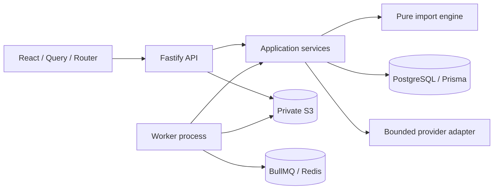

# Architecture

TypeScript modular monolith: React/Vite client, Fastify transport, application services, independent deterministic engine, shared Zod contracts, database/storage/queue adapters. API and worker are separately runnable. Production uses PostgreSQL via Prisma, Redis/BullMQ and private S3-compatible storage. A clearly labeled local mode uses embedded PostgreSQL (PGlite), filesystem objects and durable database jobs in one local process so the demonstration can run without Docker. Local mode is single-process only and is not a horizontal deployment topology.



```mermaid
sequenceDiagram
 actor Editor
 participant API
 participant DB
 participant Worker
 Editor->>API: Upload CSV and supplier
 API->>DB: Source metadata + batch + durable parse job
 Worker->>DB: Claim parse job
 Worker->>DB: Immutable source records + mapping state
 Editor->>API: Save approved configuration / exclusions
 API->>DB: Revision + preview job atomically
 Worker->>DB: Read source and catalog; save revision-bound preview
 Editor->>API: Commit preview + idempotency key
 API->>DB: Commit job + attempt
 Worker->>DB: Lock workspace; verify revision and catalog versions
 Worker->>DB: Atomic catalog writes + audit + receipt + completion
 Editor->>API: Poll result / retrieve receipt
```

Database jobs are the durable outbox. Dispatcher republishes pending work; duplicate deliveries are expected. Transactional job claiming plus import revision checks protect results. API instances contain no business state. Shared object storage and database sessions support API scaling. Work is bounded initially: parsing uses a streaming CSV parser but normalized results are assembled by a bounded worker, never sent wholesale to browser. Future larger imports need chunked staging and a carefully designed publish protocol, not partial catalog commits disguised as atomic.

Tradeoff: workspace-level advisory locking serializes catalog commits, settings changes and preview preparation, reducing throughput but making correctness reviewable. Preview reads occur inside the same workspace lock used by all application catalog writers; the transaction uses the database's default read-committed isolation. Commit rechecks affected identities. Direct database writers outside this application must honor the same locking/version protocol. Horizontal workers improve independent-workspace throughput. Product identity unique indexes remain the final defense. No claim of exactly-once queue delivery.
