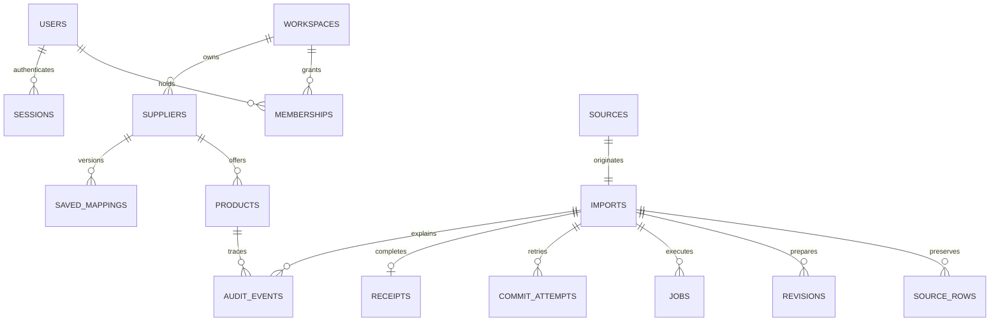

# Database model and invariants

Schema and executable migration live in `prisma/`. UUID-like IDs are application-generated opaque values. Workspace IDs appear on every business table; all repository queries scope them. Foreign keys link suppliers, imports, revisions, rows, jobs, receipts and audit. Memberships link users and workspaces with owner/editor/viewer roles. Sessions store SHA-256 digests of opaque random tokens and expiry; passwords use Argon2id.

Products contain SKU, original SKU, name, optional description, category, decimal(18,2) price, currency, unit, active, version and timestamps. Identity is unique `(workspace_id,supplier_id,sku)`. SKU normalization is Unicode NFC + outer whitespace trimming, case-sensitive, preserving leading zeros and internal spaces. Original source strings remain in immutable source records.

Sources: storage key, SHA-256, byte length, filename, uploader. Imports: supplier, source, state, current revision, progress, terminal error, timestamps. Revisions: monotonically increasing number and JSON configuration/exclusions. Source rows: unique import + logical record ordinal and raw string array. Preview rows: revision, normalized patch, classification, issue array, old values and expected product version. Preview JSON contains summary and row results; initial bounded implementation stores this snapshot in JSONB and paginates at API boundary (future normalized preview table for heavy workloads).

Saved mappings have supplier + monotonic version + exact headers + config. Suggestions preserve mode, reason, response, usage, revision and acceptance provenance in revision configuration/audit. Receipts are unique per import and include counts, revision, actor and commit key. Attempts enforce unique workspace/idempotency key. Audit is append-only by application; production DB role must deny audit UPDATE/DELETE. Jobs persist type, revision, attempts, lease and failure.

Indexes: identity unique index; imports by workspace/activity; products by workspace/supplier; rows by import/ordinal; jobs by status/available time; audit by workspace/product/time; sessions by digest. Catalog browse filters are parameterized; larger search would use pg_trgm following measurement.

Transactions:

1. Upload object first, then source/batch/job in transaction; remove object on transaction failure. Orphans after process death need retention cleanup.
2. Configuration optimistic revision check, revision insertion, old preview invalidation, durable job insertion atomically.
3. Worker preparation writes only if revision remains current.
4. Commit locks workspace, rechecks snapshot versions and absent identities, validates configured allowed values, applies products and audit, inserts unique receipt, completes attempt/import/job in one transaction. Exceptions roll everything back. Failed commit status is recorded in a separate transaction.

No external network call occurs inside catalog transactions. Constraints plus locks handle concurrent inserts. Receipts and audit preserve the exact before/after patch and source ordinal. Existing product values for unmapped fields are merged only at reconciliation.
